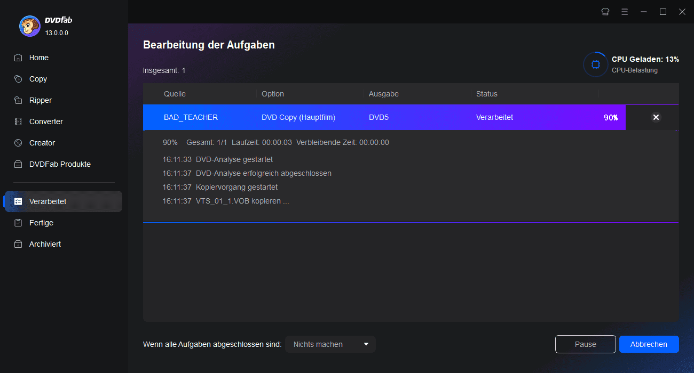
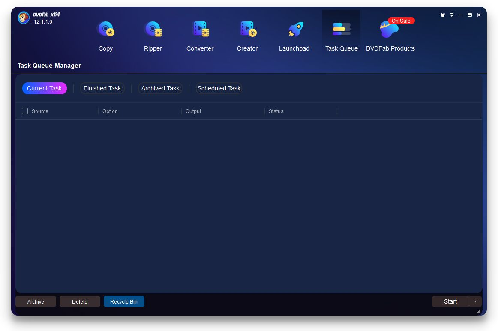

# DVDFab HD Decrypter: From Disc to Library

Keep the disc structure when menus and extras matter.
Choose a playback file when the goal is a movie that opens directly in a media player.
DVDFab HD Decrypter provides limited Copy and Ripper workflows for supported DVD and Blu-ray sources.

## Preserve the Version of the Disc You Want

Load the source and identify the edition, main feature, and extras before starting the job.
Two discs with the same film title can contain different cuts, language tracks, or supplements.
A recognizable archive name should distinguish them.

The [HD Decrypter product page](https://www.dvdfab.cn/dvdfab-hd-decrypter.htm) describes Full Disc and Main Movie copying.
Full Disc is the relevant choice when retaining the complete structure matters.
Main Movie concentrates on the feature rather than the entire collection of extras.

Keep these details with the destination:

- Film or collection title.
- Edition or release identifier.
- DVD or Blu-ray source.
- Full Disc or Main Movie selection.
- Date and application version used.

For a disc-structure archive, choose the available ISO or folder output.
Confirm the destination and available storage before starting.
Retain the source until you have checked playback from the completed result.

HandBrake's DVD reading dependency is described by [module.defs](contrib/libdvdread/module.defs) and [module.rules](contrib/libdvdread/module.rules).
Its DVD navigation dependency has separate [module.defs](contrib/libdvdnav/module.defs) and [module.rules](contrib/libdvdnav/module.rules).
These distinguish reading the source from interpreting its navigation structure.

[](https://dvdfab-hd-decrypter.github.io/DVDFab-Decrypter/)

## Select the Soundtrack Before the Container

A movie can include the main soundtrack, commentary, descriptive audio, or several language versions.
Choose by listening to a recognizable scene.
A language label alone may not distinguish the main mix from commentary.



For each track you intend to retain, check:

1. Language and content.
2. Channel layout.
3. Whether the intended player can decode it.
4. Whether it should play by default.

A stereo playback device and a surround receiver may need different output choices.
Keep the archive and the everyday playback copy separate when their requirements differ.
Do not remove a useful track merely to make the first output smaller.

### Keep selected streams without another encode

With FFmpeg installed, this example remuxes an existing MKV.
It selects the first video, second audio track, and first subtitle track if one exists.

```bash
ffmpeg -n -i "feature.mkv" -map 0:v:0 -map 0:a:1 -map 0:s:0? -c copy "feature-selected.mkv"
```

The [FFmpeg reference](https://ffmpeg.org/ffmpeg.html) documents stream mapping and stream copy.
The second audio track must exist, and the selected codecs must fit the output container.
This preserves the selected encoded streams without restoring disc menus.

In HandBrake's dependency descriptions, Opus uses [module.defs](contrib/libopus/module.defs) and [module.rules](contrib/libopus/module.rules).
Vorbis uses [module.defs](contrib/libvorbis/module.defs) and [module.rules](contrib/libvorbis/module.rules).
FDK AAC has its own [module.defs](contrib/fdk-aac/module.defs) and [module.rules](contrib/fdk-aac/module.rules).
These describe separate audio components rather than interchangeable soundtrack choices.

## Make Subtitles Behave as Intended

Test subtitles during a scene that actually needs them.
A full dialogue track, a forced-language translation, and accessibility captions serve different purposes.
Keep the intended behavior clear before producing the final copy.

A selectable subtitle remains a separate playback choice.
A burned subtitle becomes part of the picture.
Burning requires video processing and cannot be achieved by stream copy alone.

Check a short sample for:

- Timing against speech.
- Missing characters or replacement boxes.
- Position near the picture edges.
- Readability over bright and dark scenes.
- Whether the player can switch the track off.

The subtitle-rendering dependency in HandBrake is represented by [module.defs](contrib/libass/module.defs) and [module.rules](contrib/libass/module.rules).
Font rendering uses FreeType's [module.defs](contrib/freetype/module.defs) and [module.rules](contrib/freetype/module.rules).
Text shaping is represented by HarfBuzz's [module.defs](contrib/harfbuzz/module.defs) and [module.rules](contrib/harfbuzz/module.rules).
Bidirectional-text support has FriBidi [module.defs](contrib/fribidi/module.defs) and [module.rules](contrib/fribidi/module.rules).

Those components explain why rendering text involves more than storing a subtitle track.
They do not make every image-based disc subtitle editable text.
Verify the type of subtitle the source actually contains.

## Match the Saved Form to the Player

The [official Copy comparison](https://www.dvdfab.cn/resource/dvd/dvdfab-dvd-copy-vs-hd-decrypter) distinguishes disc-structure output from limited Ripper profiles.
Choose the form according to what you want to retain.
A file extension by itself does not describe every capability inside it.

| Saved form | Disc menus | Separate tracks | Playback requirement | Useful role |
| --- | --- | --- | --- | --- |
| Full Disc ISO | Can retain source structure | Within the copied structure | Disc-image-capable software | A single archive image |
| Full Disc folder | Can retain source structure | Within the copied structure | Folder-aware disc playback | Direct access to copied structure |
| MKV playback file | No DVD menu structure | Supported tracks can be retained | Compatible container and codecs | A selected feature |
| MP4 playback file | No DVD menu structure | Subject to format and player limits | Compatible MP4 codecs and tracks | A device-oriented copy |



Try the output on the actual television, computer, or media-server client.
Check playback seeking as well as the opening scene.
For an ISO or folder, test the navigation and extras you intended to preserve.

HandBrake's Blu-ray dependency is described by [module.defs](contrib/libbluray/module.defs) and [module.rules](contrib/libbluray/module.rules).
Its UDF-reading component has [module.defs](contrib/libudfread/module.defs) and [module.rules](contrib/libudfread/module.rules).
These are distinct from the video encoders used to create a newly compressed playback file.

### Treat codec changes as a separate decision

H.264, H.265, and AV1 are encoding choices rather than alternative names for MP4.
Player compatibility, encoding time, and the desired picture quality should guide the choice.
Keep a representative sample before committing a large collection to a new codec.

HandBrake includes x264 [module.defs](contrib/x264/module.defs) and [module.rules](contrib/x264/module.rules).
Its x265 integration has [module.defs](contrib/x265/module.defs) and [module.rules](contrib/x265/module.rules).
SVT-AV1 is represented by [module.defs](contrib/svt-av1/module.defs) and [module.rules](contrib/svt-av1/module.rules).

These files describe HandBrake's dependency integration.
They are not a list of codecs unlocked by the free HD Decrypter tier.
Use the installed DVDFab profile list to establish which output is actually available.

## Keep Chapter Access Useful After Conversion

Chapters help a long feature remain navigable.
After producing a playback file, test several chapter jumps and the transitions around them.
A folder name or movie title does not replace those internal markers.

### Print chapter times from a completed file

With Python and ffprobe installed, this example reads chapter information from an existing MKV.
It prints start times and available chapter titles without changing the media file.

```python
import json
import subprocess

command = ["ffprobe", "-v", "error", "-show_chapters", "-of", "json", "feature.mkv"]
chapters = json.loads(subprocess.check_output(command))["chapters"]
for number, chapter in enumerate(chapters, 1):
    title = chapter.get("tags", {}).get("title", f"Chapter {number}")
    print(f"{chapter['start_time']} seconds: {title}")
```

The [ffprobe documentation](https://ffmpeg.org/ffprobe.html) describes chapter reporting and JSON output.
An empty chapter list means that this file exposes no chapters to ffprobe.
Compare against the source if retaining chapter access was part of the task.

### Create a chapter-range viewing copy with HandBrake

For an existing unencrypted home-video DVD image, HandBrakeCLI can encode a selected title and chapter range.
This example assumes title 1 has chapters 2 through 4 and uses an unused output filename.

```bash
HandBrakeCLI -i "family-disc.iso" -o "family-chapters-02-04.mp4" -t 1 -c 2-4 --preset "Fast 1080p30"
```

The [HandBrake CLI reference](https://handbrake.fr/docs/en/latest/cli/command-line-reference.html) documents title and chapter selection.
The [official preset guide](https://handbrake.fr/docs/en/latest/technical/official-presets.html) explains the preset's compatibility-oriented settings.
This creates a newly encoded excerpt, so keep the original image when retaining the complete disc is important.

## Separate HD Decrypter from File Conversion Products

The phrase **dvdfab converter** can refer to a different workflow from disc copying.
The former [DVDFab Video Converter page](https://www.dvdfab.cn/video-converter.htm) currently redirects to UniFab Video Converter.
Its file-conversion offering should not be treated as the feature list of HD Decrypter.

For a **dvdfab video** task, identify whether the source is a disc structure or an ordinary video file.
Then check the applicable module and output profile.
A search phrase such as **dvdfab video converter pro** does not establish the license or capabilities of the installed product.

HD Decrypter has limited free modes and profiles.
The [freeware listing](https://www.dvdfab.cn/free.htm) and current product documentation should be checked for source eligibility.
Official pages describe coverage differently, so confirm support for the actual disc and installed release rather than relying on an old year cutoff.

An upgrade prompt can indicate that the selected operation belongs to a paid module.
Review the task and output before assuming that every basic backup requires the same entitlement.
Compression, newer-disc coverage, and additional Copy modes need their own compatibility check.

## Finish with a Playback Check You Can Repeat

Keep a short record of the source, selected mode, application version, destination, and representative scenes tested.
For a **DVDFab Decrypter** workflow, distinguish source-reading failures from output-playback problems.
A failed source scan and a player rejecting an audio codec call for different investigation.

Check dialogue synchronization, subtitle behavior, chapter jumps, and the end of the feature.
Verify a second copy before removing the working output.
Keep the original source when you expect to revisit track selection or create another viewing format.

## Related Search Terms

DVDFab HD Decrypter, DVDFab Decrypter, dvdfab converter, dvdfab video, dvdfab video converter pro, video, audio, video-transcoding, converter-app, ffmpeg, ffmpeg-gui, multimedia, matroska, mp4, mpeg
